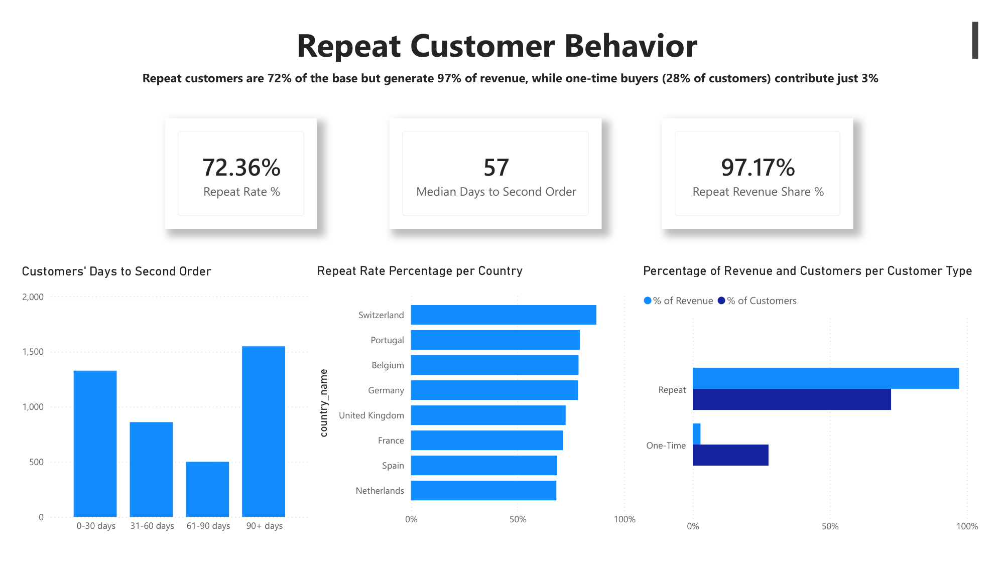
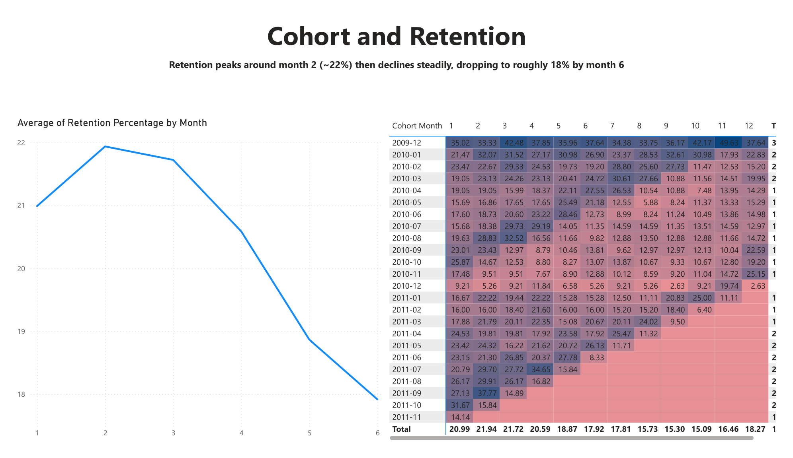
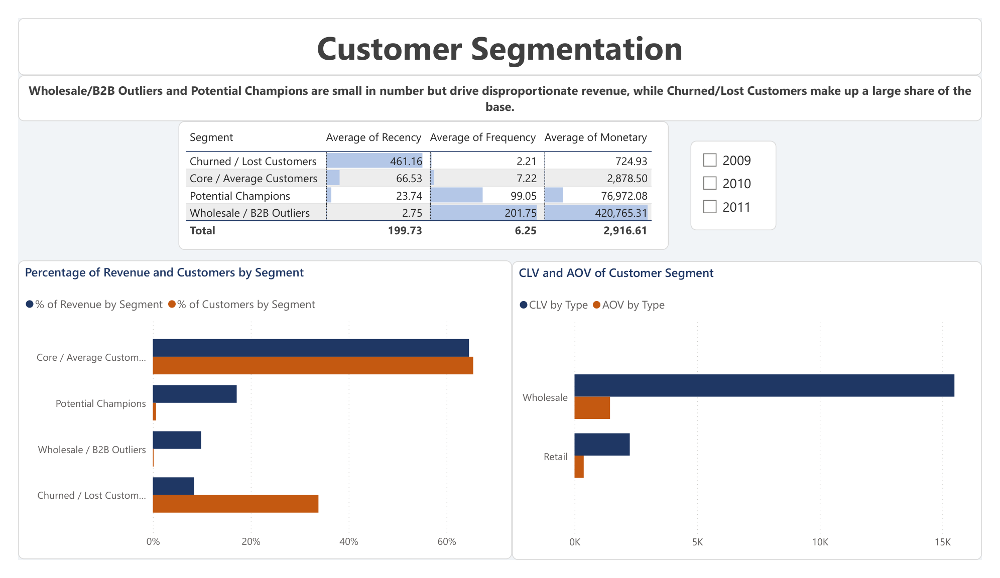

# Case Study: Where Does the Revenue Come From, and How Much of It Is at Risk?

**An end-to-end retention analysis of 1M+ transactions from a UK online retailer**
SQL Server · Python · Power BI

> **The short version:** 72% of customers reorder and generate 97% of revenue, but half of all identified customers (51%) have gone quiet for 90+ days, holding £3.30M of past spend. The cheapest place to act is the gap between a customer's first and second order: the median is 57 days, and only 31% of repeat customers come back within 30.

[Video walkthrough (3 min)](https://youtu.be/I_UvFsbfLRI) · [Dashboard report (PDF)](power_bi/Retention_Analysis.pdf) · [Print-friendly one-page version (PDF)](Executive_Summary.pdf) · [Code and documentation](README.md)

---

## The question

An online retailer has two years of order data and a simple worry: sales look steady, but is the business leaning on customers who are quietly leaving? I set out to answer three things:

1. Who are the repeat customers, and how much do they matter?
2. When do customers stop coming back?
3. Which lapsed customers are worth contacting first?

## The data, and what I fixed before analysing it

The data is the public *Online Retail II* dataset (UCI, CC BY 4.0): 1,067,371 invoice lines, December 2009 to December 2011, £19.64M of revenue, 39,516 orders and 5,852 identified customers.

Before any analysis I profiled and cleaned it in T-SQL, because a retention number is only as good as the customer records behind it:

- Two source sheets overlapped in December 2010, so 22,523 rows appeared twice. I removed one copy.
- I removed 11,812 further duplicate rows, then reconciled revenue back to £19.64M so every later figure traces to one total.
- Cancellations (invoices starting with "C") are excluded from revenue and repeat-purchase counts.
- Guest checkouts have no customer ID (13.1% of revenue, £2.58M). They are left out of customer-level metrics, so everything about customers describes 86.9% of revenue.

I then modelled the data as a Kimball star schema in SQL Server, so the SQL, Python and Power BI layers all read from the same definitions.

## What I did, and why

| Step | Method | Why this method |
|---|---|---|
| Segment customers | RFM (recency, frequency, monetary value) plus K-Means | Customers differ so much in value that an average hides the story. Clustering lets the data define the groups. |
| Measure retention | Monthly cohorts in T-SQL (CTEs, window functions) | It shows *when* customers drop off, which a single churn rate cannot. |
| Score churn risk | Logistic regression on order frequency and spend | Simple, explainable, and enough to rank who to contact first. |
| Report | Six-page Power BI dashboard, 21 DAX measures | A non-technical reader can follow it page by page. |

## What I found

**1. Repeat buyers are the business.** 4,234 repeat customers (72%) generate £16.51M of the revenue (97%). A repeat customer is worth about £3,900 in lifetime revenue, a one-time buyer about £344.

**2. The first-to-second order gap is the lever.** The median time to a second order is 57 days, and only 31% of repeat customers return within 30 days. About 28% of first-time buyers never reorder at all.

**3. Retention peaks early and then erodes.** Retention is about 22% in month 2 and about 18% by month 6. Cohorts return more strongly in October and November (24% and 28%) than in January and February (13%).

**4. Revenue is concentrated in three ways.** One country (the UK, 85.5%), one season (September to November, 29% of January-to-November revenue in both years), and a few accounts (42 customers hold 27% of identified revenue: 38 "Potential Champions" and 4 wholesale accounts).

**5. Most of the revenue at risk is not in the "Lost" segment.** 2,967 customers (51%) have not bought for 90+ days and hold £3.30M of past spend. Of that, Core/Average customers hold £1.76M (53%) and the Lost segment £1.44M (43%). Retention effort aimed only at "Lost" customers would miss more than half of it.

**6. The findings hold up statistically, and most of the future value is not in "Lost".** Repeat customers spend a median of £1,364 against £229 for one-time customers (difference £1,135, 95% interval £1,068 to £1,200), the median second order comes at 57 days (54 to 60), and customers order 8.6 points more often in October and November than in January and February ([Statistical_Tests.md](docs/Statistical_Tests.md)). A lifetime value model (BG/NBD and Gamma-Gamma, predicting the number of orders in a hold-out period within 2%) puts the expected spend of existing customers over the next 12 months at £9.1M, of which the "Lost" segment holds only 4.7% ([Customer_Lifetime_Value.md](docs/Customer_Lifetime_Value.md)).

## What I would recommend

Ranked by revenue at stake and how easy each is to run. These are my judgement and **none has been tested**.

1. **Follow up new customers at day 30**, with a reminder before day 57. Track second-order conversion within 60 days.
2. **Assign account management to the 42 top accounts** (£4.61M of past spend). Track their order frequency and spend.
3. **Win back lapsed customers, highest value first:** the top 100 churned Core/Average customers (£0.88M), then the 589 who lapsed 91 to 180 days ago (£1.01M). Measure against a held-out group that is not contacted, so the campaign's effect can actually be seen.
4. Add a loyalty or replenishment nudge in months 2 to 3, ahead of the September to November peak.
5. Reduce reliance on the UK and on Q4.
6. Audit the long tail of the bottom 2,344 products (4.6% of revenue).

## How much to trust this

I would rather state the limits than have a reader find them.

**What the churn score is, and is not.** A customer is labelled *churned* if they have not ordered for more than 90 days. The logistic regression then gives every customer a *churn risk score* from order frequency and spend (recency is excluded, because it defines the label). The label and features come from the same snapshot, so the score describes who looks like a lapsed customer **today**. It is **not a forecast** of who will leave next. That is why customers already labelled "Churned / Lost" score high on the dashboard: they are the group the model describes, not a prediction about the future. The score is useful for ranking outreach, not for predicting individual behaviour. Its ROC-AUC is 0.77, only slightly above a simple "fewer orders means more likely churned" rule (0.76), so most of the signal is order frequency. A forward-looking version uses features up to a cut-off date and measures the outcome in the following 90 days. I built it and tested it on a later period: with recency and the gap between orders added, the ROC-AUC is 0.79 to 0.80, against 0.75 for the original two features, and a more complex model (random forest, gradient boosting) does no better than logistic regression. The probabilities over-predict churn in the later period, so the ranking is reliable and the absolute numbers are not ([Churn_Model_Evaluation.md](docs/Churn_Model_Evaluation.md)).

**"Revenue at risk" is past spend.** The £3.30M is what churned customers spent historically. It is not a forecast, and it is not what a win-back campaign would recover.

**The 90-day rule can mislabel seasonal buyers.** Returns are strongest in autumn, so some customers counted as churned in the summer will come back in October. The real figure at risk is probably lower than £3.30M: moving the threshold from 60 to 180 days moves it from £4.27M to £2.29M, and on earlier snapshots about a quarter of the customers labelled churned at 90 days ordered again within the next 90 days ([Sensitivity_and_Forecast.md](docs/Sensitivity_and_Forecast.md)).

**Two kinds of "inactive".** "Lost" (1,980 customers) is a K-Means segment. "Churned" (2,967) is the 90-day rule. They overlap but are not the same group.

**Other limits.** The findings are descriptive, not causal. The dataset has no cost data, so this is revenue, not profit. Retention averages across cohorts are unweighted, and the first cohort (December 2009) retains 33 to 50%, so month 6+ figures are indicative. The final month (December 2011) is partial.

## What I would do next

- Add product mix to the churn model, and recalibrate its probabilities for each season.
- Test recommendation 1 with a controlled follow-up message and compare second-order rates against a group that gets none.
- Replace the fixed 90-day rule with a threshold based on each customer's own ordering rhythm. The BG/NBD model already gives a probability of being still active for every customer.
- Fit seasonal forecasts when more than two years of data are available. The six-month revenue forecast has a wide range because only 12 year-on-year ratios exist ([Sensitivity_and_Forecast.md](docs/Sensitivity_and_Forecast.md)).

---

*Built by Giannis Psomas · [LinkedIn](https://www.linkedin.com/in/giannispsomas) · [GitHub](https://github.com/giannispsomas)*
