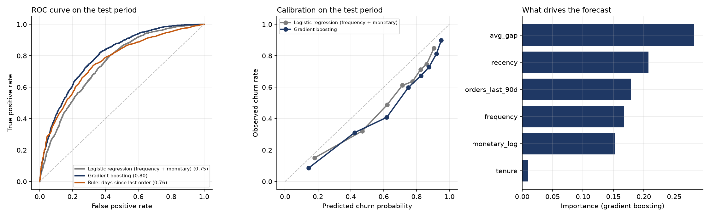

# Churn Model Evaluation

The churn model in `python/churn_regr.ipynb` labels a customer as churned from the same snapshot that its features come from, so it describes who looks lapsed today and is not a forecast (see "How much to trust this" in the [case study](../Case_Study.md)). This note builds the forward-looking version and tests it on a later period. The code is [python/02_churn_model_evaluation.py](../python/02_churn_model_evaluation.py), and the results are in `python/results/`.

## Method

- **Label:** the customer places no order in the 90 days after a snapshot date. The features use only orders up to the snapshot.
- **Time-based split:** the models are trained at the snapshot of 2011-06-10 (4,951 active customers, outcome known by 2011-09-08) and tested at the snapshot of 2011-09-10 (5,256 customers, outcome known at the end of the data on 2011-12-09). The test period has no overlap with anything the models saw.
- **Features:** days since the last order (recency), number of orders, total spend (log), days since the first order, orders in the last 90 days, and the average gap between orders. The original model uses only the number of orders and the spend.
- **Models:** logistic regression on the two original features, logistic regression on all six, a random forest and gradient boosting. Two simple rules are baselines: "the longer since the last order, the more likely to churn" and "the fewer orders, the more likely".
- **Evaluation:** ROC-AUC (5-fold cross-validation on the training period, and on the test period), average precision, Brier score, calibration, and what happens when the 20% of customers with the highest risk are contacted.

## Results on the test period

| Model | ROC-AUC, cross-validation | ROC-AUC, test | Average precision | Precision, top 20% | Recall, top 20% |
|---|---|---|---|---|---|
| Gradient boosting | 0.825 | **0.797** | 0.815 | 86.7% | 30.7% |
| Logistic regression (all features) | 0.819 | 0.793 | 0.814 | 87.3% | 30.9% |
| Random forest | 0.819 | 0.790 | 0.801 | 85.6% | 30.3% |
| Rule: days since last order | n/a | 0.763 | 0.798 | 86.3% | 30.6% |
| Logistic regression (frequency and spend, the original) | 0.781 | 0.750 | 0.768 | 81.1% | 28.7% |
| Rule: fewer orders | n/a | 0.747 | 0.744 | 80.4% | 28.5% |

In the test period 56.4% of the customers did not order in the next 90 days. Contacting the top 20% by risk finds churners 87% of the time, against 56% by chance (a lift of 1.5). It reaches about 31% of all churners.

The 95% bootstrap interval of the test AUC is 0.737 to 0.763 for the original model and 0.786 to 0.809 for gradient boosting.

## What this shows

- **The forward-looking version works.** An AUC of 0.79 to 0.80 on a later period means the model ranks future churners above future stayers. It is a real forecast, which the original score was not.
- **The original two features are not enough.** Adding recency, orders in the last 90 days and the average gap between orders moves the AUC from 0.75 to 0.79. A simple recency rule (0.763) already beats the original model.
- **A more complex model does not help.** Gradient boosting (0.797) and random forest (0.790) are no better than logistic regression on the same features (0.793). The differences are within the sampling interval, so the simple, explainable model is the right choice.
- **The average gap between orders matters most** (28% of the gradient-boosting importance), then recency (21%) and orders in the last 90 days (18%). This fits the retention finding: customers who order at a regular rhythm are the ones who stay.
- **Calibration is the weak spot.** Both models over-predict churn on the test period: the observed churn rate is below the predicted one, mostly by 5 to 15 points in the middle of the range. The reason is that the training period had a higher churn rate (68%) than the test period (56%), because the test window covers September to November, the busiest months. The ranking is good, but the probabilities should be recalibrated before they are read as probabilities for a new season.

## Limits

- Two snapshots only, with a 90-day window. The result describes how the model would have worked in 2011 and not necessarily in other years.
- "No order in 90 days" is still a fixed rule and can label a seasonal buyer as churned.
- The model ranks customers but does not say which outreach would bring them back. That needs a controlled test.
