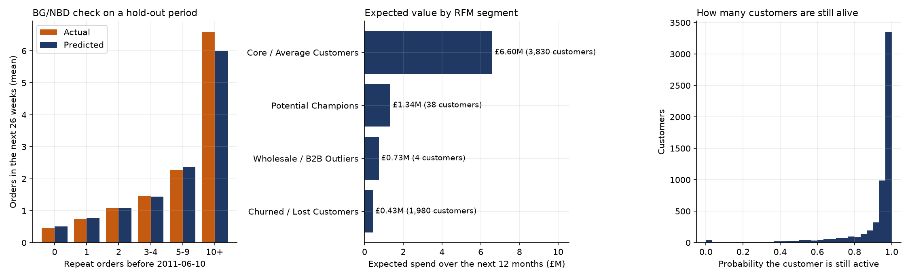

# Customer Lifetime Value

The case study uses past spend as a proxy for value (the "CLV proxy" in the assumptions). This note estimates what customers are expected to spend in the next 12 months, with the BG/NBD and Gamma-Gamma models. The code is [python/04_customer_lifetime_value.py](../python/04_customer_lifetime_value.py), written with scipy so that no extra package is needed. The results are in `python/results/`.

## Method

- **BG/NBD** (Fader, Hardie and Lee, 2005) models how often a customer orders while active and when the customer becomes inactive. It needs three numbers per customer: the number of repeat order days, the age of the customer at the last order, and the age at the end of the data.
- **Gamma-Gamma** (Fader and Hardie, 2013) models the value of an order, assuming that value is independent of how often the customer orders.
- The expected 12-month spend is the expected number of orders in the next 52 weeks times the expected order value.
- **Validation.** The models were fitted on the data up to 2011-06-10 and used to predict the number of orders in the next 26 weeks. The prediction was compared with what the customers did.

## Validation on a hold-out period

| Repeat orders before 2011-06-10 | Customers | Predicted orders in 26 weeks (mean) | Actual (mean) |
|---|---|---|---|
| 0 | 1,610 | 0.50 | 0.45 |
| 1 | 886 | 0.77 | 0.75 |
| 2 | 563 | 1.08 | 1.08 |
| 3 to 4 | 721 | 1.44 | 1.45 |
| 5 to 9 | 702 | 2.36 | 2.28 |
| 10 or more | 469 | 5.99 | 6.60 |

In total, the model predicted 7,606 orders and 7,735 happened (-1.7%). The correlation between predicted and actual orders per customer is 0.85. The model slightly under-predicts the most frequent customers (10 or more orders: 6.0 against 6.6).

## Expected 12-month spend (all data, existing customers)

The models were then refitted on all data. For the 5,852 customers, the expected spend over the next 12 months is **£9.10M**. By RFM segment:

| Segment | Customers | Probability still active (mean) | Expected spend, mean per customer | Expected spend, total | Share |
|---|---|---|---|---|---|
| Core / Average | 3,830 | 0.96 | £1,722 | £6.60M | 72.5% |
| Potential Champions | 38 | 0.94 | £35,173 | £1.34M | 14.7% |
| Wholesale / B2B Outliers | 4 | 1.00 | £183,722 | £0.73M | 8.1% |
| Churned / Lost | 1,980 | 0.82 | £218 | £0.43M | 4.7% |

The top 10% of customers hold 58% of the expected value.

## What this shows

- **The "Lost" segment holds little future value.** It has 34% of the customers but only 4.7% of the expected 12-month spend (£218 per customer, against £1,722 for Core / Average). This agrees with the case study: win-back effort aimed only at "Lost" customers would miss most of the value, which sits in Core / Average and Potential Champions.
- **The 90-day rule is harsh on regular buyers.** The mean probability of being still active is 0.96 for Core / Average and 0.82 even for the "Lost" segment. Many customers with a long gap between two orders are, according to the model, still customers.
- **Value is concentrated.** 42 customers (Potential Champions and Wholesale) hold 23% of the expected spend.

## Limits

- The models treat order value as independent of order frequency. In this data the wholesale accounts break that assumption, so their expected value (£184K each, from 4 customers) is uncertain.
- The BG/NBD model assumes a stable purchase rate and does not model seasonality, which is strong in this retailer (autumn). The hold-out period (June to December) includes the autumn peak, and the prediction held up well, but the result for one year does not prove it for others.
- Only identified customers are included. There is no margin in the data, so this is expected revenue, not expected profit.
