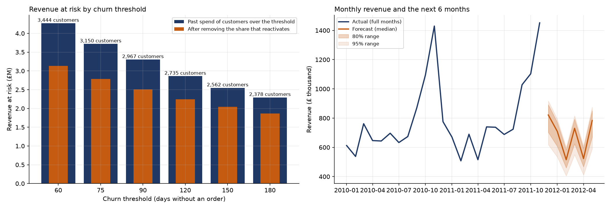

# Sensitivity and Forecast

Two questions the case study leaves open: how much does the £3.30M "revenue at risk" depend on the 90-day rule, and what revenue should the business expect over the next six months? The code is [python/03_sensitivity_and_forecast.py](../python/03_sensitivity_and_forecast.py), and the results are in `python/results/`.

## A. Sensitivity of the revenue at risk to the churn threshold

The threshold is moved from 60 to 180 days without an order. For each threshold, the script also asks how many of the customers it would have labelled churned went on to order within the next 90 days. It checks this on four earlier snapshots (2010-09-10, 2010-12-09, 2011-03-10 and 2011-06-10), so that the answer comes from real outcomes.

| Threshold (days) | Churned customers | Share of customers | Past spend of these customers | Reactivated within 90 days (average of four snapshots, range) | Past spend after removing the reactivated share |
|---|---|---|---|---|---|
| 60 | 3,444 | 58.9% | £4.27M | 26.7% (16.5% to 47.4%) | £3.13M |
| 75 | 3,150 | 53.8% | £3.72M | 25.2% (14.6% to 45.9%) | £2.78M |
| **90** | **2,967** | **50.7%** | **£3.30M** | **24.0% (13.3% to 44.3%)** | **£2.51M** |
| 120 | 2,735 | 46.7% | £2.86M | 21.4% (12.2% to 40.5%) | £2.25M |
| 150 | 2,562 | 43.8% | £2.55M | 19.8% (11.1% to 37.7%) | £2.05M |
| 180 | 2,378 | 40.6% | £2.29M | 18.7% (10.6% to 37.5%) | £1.86M |

**What this shows**
- The headline depends on the rule. Between 60 and 180 days, the share of customers labelled churned moves from 59% to 41%, and the past spend at risk from £4.27M to £2.29M. The 90-day figures are in the middle of that range.
- **About a quarter of the customers labelled churned at 90 days come back within the next 90 days** on average (13% to 44%, depending on the season). The rule labels many of them too early, which supports the warning in the case study that the real figure at risk is probably lower than £3.30M. A rough estimate removes the average reactivation share and gives about £2.5M.
- The "past spend after removing the reactivated share" is an approximation. It assumes reactivated customers spent the same as the others.

## B. Revenue forecast for the next six months

**Method.** The forecast for a month is the same month of the previous year, multiplied by a year-on-year ratio. The ratio is drawn from the 12 ratios observed between 2011 and 2010 (they range from 0.80 to 1.18), 10,000 times, which gives the median and the ranges. Only two years of data are available, so a seasonal model with fitted trends would not be reliable. December 2011 is a partial month and is left out of the history.

**Backtest.** The same method was used to forecast July to November 2011 from July to November 2010, with the ratios of January to June 2011 only. The median forecast was off by 11% on average (mean absolute percentage error), and four of the five actual months fell inside the 80% range.

**Forecast** (revenue of all valid sales, including guest checkouts):

| Month | Median | 80% range | 95% range |
|---|---|---|---|
| December 2011 | £821K | £702K to £892K | £618K to £918K |
| January 2012 | £710K | £607K to £771K | £535K to £793K |
| February 2012 | £516K | £460K to £584K | £405K to £601K |
| March 2012 | £730K | £625K to £793K | £550K to £816K |
| April 2012 | £523K | £467K to £593K | £411K to £610K |
| May 2012 | £783K | £670K to £851K | £590K to £875K |

## Limits

- The forecast repeats the seasonal pattern of the last year. It cannot see a change in trend, a promotion or a change in the customer base.
- The ranges are wide because only 12 year-on-year ratios exist. They are a fair picture of the uncertainty and not a precise bound.
- The reactivation rates come from a retailer with strong autumn buying, so the range between snapshots is large.
