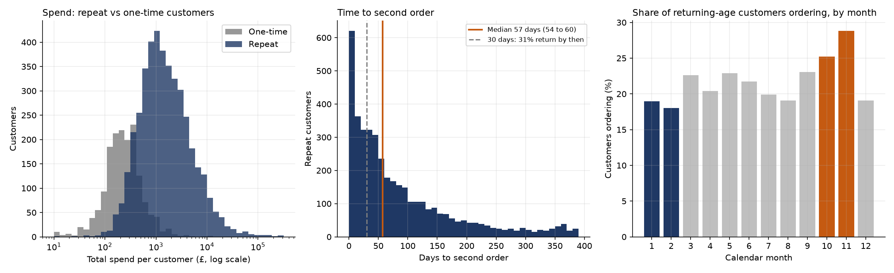

# Statistical Tests

The case study states three findings as they appear in the data. This note tests whether they are larger than chance. The code is [python/01_statistical_tests.py](../python/01_statistical_tests.py), and the results are in `python/results/`.

## Method

- **Intervals** are 95% bootstrap intervals (5,000 resamples, fixed seed).
- **Spend** is compared with a Mann-Whitney U test, because spend is heavily skewed, and with the difference in medians and Cliff's delta (an effect size from -1 to 1, where 0 means no difference).
- **Seasonality** compares the share of customer-months with an order. A customer-month is one customer in one calendar month after their first-order month (December 2011 is left out because it is partial). The same customer appears in many customer-months, so the interval resamples customers, not rows.

## Results

**A. Repeat customers spend far more than one-time customers**

| Customers | Median spend, repeat | Median spend, one-time | Difference in medians (95% interval) | Cliff's delta |
|---|---|---|---|---|
| All identified (4,234 repeat, 1,618 one-time) | £1,364 | £229 | £1,135 (£1,068 to £1,200) | 0.84 |
| With 90+ days of history (4,005 and 1,251) | £1,433 | £221 | £1,212 (£1,152 to £1,292) | 0.86 |

The Mann-Whitney p-value is below 0.001 in both rows. The second row removes customers whose first order is too recent to show a second one, because those can only be one-time customers. The result does not change. Mean spend is £3,900 for repeat customers and £344 for one-time customers.

**B. Time to a second order**

| Metric | Value | 95% interval |
|---|---|---|
| Median days to a second order (4,234 repeat customers) | 57 | 54 to 60 |
| Repeat customers returning within 30 days | 31.3% | 29.9% to 32.7% |

**C. Customers return more in autumn than in winter**

| | Share of customer-months with an order |
|---|---|
| Autumn (October and November) | 27.1% (25.2% and 28.8%) |
| Winter (January and February) | 18.5% (19.0% and 18.0%) |
| Difference | 8.6 points (95% interval 7.6 to 9.5) |

The chi-square test gives a statistic of 278.6 and p below 0.001, on 18,496 autumn and 10,972 winter customer-months.

## What holds and what to watch

- **All three findings are far larger than chance.** The intervals are narrow, because there are thousands of customers.
- **Statistical significance is not the same as a cause.** Repeat customers spend more partly because they ordered more often, and the data cannot say whether a day-30 follow-up would create more repeat customers. The recommendation still needs a controlled test.
- **The seasonal figures differ from the case study** (24% and 28% in October and November, 13% in January and February). The case study reads them from the dashboard's cohort table, which averages cohorts. This note uses customer-months, which weights every customer equally. The direction and the size of the gap are the same.
- Only two winters and two autumns are in the data, so the seasonal difference describes these two years.
